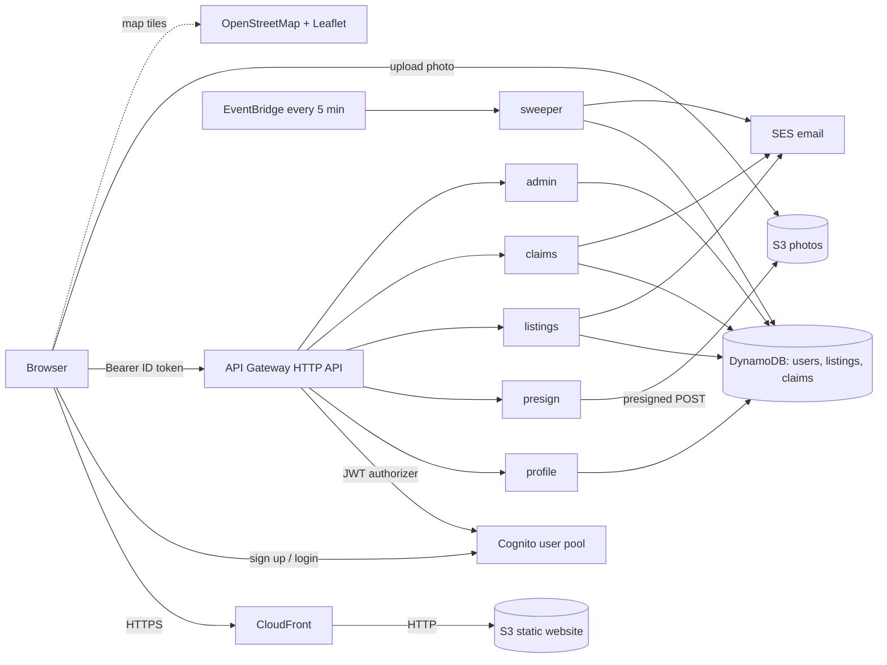
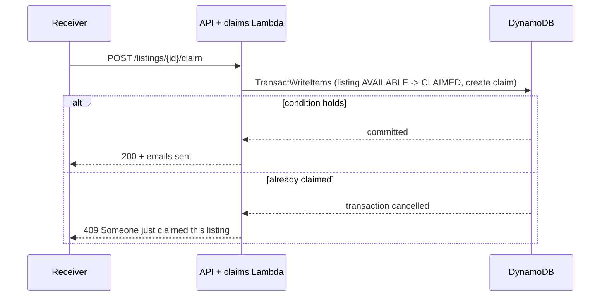

# FoodBridge Architecture

Serverless on AWS (us-east-1), built inside an AWS Academy Learner Lab.

## Components
| Layer | Service | Notes |
|---|---|---|
| Delivery | CloudFront + S3 website | HTTPS, security headers, cached copies |
| Identity | Cognito | Email sign-in, groups Admin / Donor / Receiver, immutable requestedRole |
| API | API Gateway HTTP API | 19 routes, JWT authorizer, CORS allow-list, throttled (10 rps, burst 20) |
| Logic | 6 Lambda functions (Python 3.12) + shared layer | profile, presign, listings, claims, admin, sweeper; all run as LabRole |
| Data | DynamoDB on-demand | 3 tables, 8 GSIs, 12 access patterns |
| Media | S3 | Presigned POST (5 MB, JPEG/PNG/WebP), public read on listings/ only |
| Automation | EventBridge rule rate(5 minutes) | Expiry and pickup reminders |
| Email | SES (sandbox) | Verified identities only |
| Maps | Leaflet + OpenStreetMap | No API key, no cost |

## Key flows
**Claim without double-claiming**

**Expiry:** reads hide listings past `expiresAt` immediately; the sweeper persists `EXPIRED` and sends one pickup reminder per claim.

**Nearby search:** 5-character geohash cells cover the radius (up to 10 km), then Haversine filters exactly. Larger radii use the status index.

## Security model
- Every route requires a verified Cognito JWT; roles come from Cognito groups, never from the browser.
- Admin accounts exist only when added to the Admin group by hand; signups can request DONOR or RECEIVER only.
- Server-side validation of all input; conditional writes protect state transitions.
- Photos: presigned POST with size and type conditions and a per-donor key prefix.
- CORS allow-list on API and photo bucket; throttling on the stage.
- Least privilege within the lab: LabRole only, public read limited to listing photos.
- Known gap: the website bucket is public (CloudFront in front, but not exclusive).

## Why serverless instead of EC2
No servers to patch or restart, no idle cost, conditional writes give atomic claims, and the whole system costs a small fraction of the $50 budget. An EC2 + RDS design would run about $15 to $30 per month if left on.

## Limits and next steps
SES sandbox (verified recipients only), demo-scale nearby-receiver lookup, no CSP or SRI yet, no automated CI deploy, CloudFront OAC with a private bucket for production.